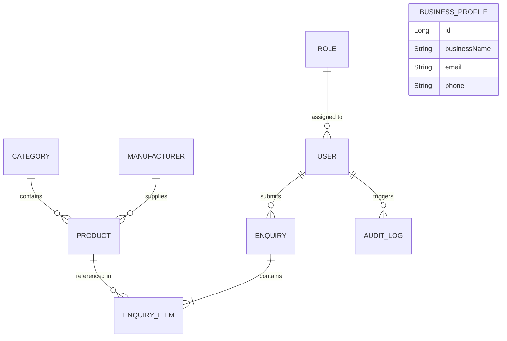

# LabDistrib — Planned Database Design

> [!IMPORTANT]
> **STATUS: PLANNED — NOT YET IMPLEMENTED**  
> This document details the database architecture planned for the **C.K.Traders — Laboratory & Pathology Equipment Distribution Management System** (`labdistrib`).  
> **Stage 1 is documentation only.** No database tables, schemas, or Java entity classes have been created yet. The actual database will be configured and auto-generated by Hibernate in a later implementation stage.

---

## 1. Overview

In modern Java web development, particularly when using the **Spring Boot** framework, we do not start by manually writing raw SQL `CREATE TABLE` scripts in MySQL. Instead, we use an approach called **Object-Relational Mapping (ORM)** powered by **JPA (Java Persistence API)** and **Hibernate**.

### How It Works (Conceptually)
1. **Java Entities First:** We define standard Java classes (called **Entities**) that represent the business objects in our system (such as `Product`, `User`, `Category`).
2. **JPA Annotations:** We mark those Java classes and their fields with special annotations (like `@Entity`, `@Table`, `@Id`, `@Column`, `@ManyToOne`).
3. **Hibernate Auto-Generation:** When the Spring Boot application launches, Hibernate connects to MySQL, reads our Java entity definitions, and automatically creates or updates the corresponding relational database tables, columns, primary keys, and foreign keys.
4. **Spring Data JPA Repositories:** Later on, instead of typing SQL queries like `SELECT * FROM products WHERE category_id = ?`, we will use Spring Data JPA repository interfaces that generate standard database queries for us automatically.

```
+-------------------------------------------------------------+
|                     Java Application                        |
|   [ Product.java ]  [ User.java ]  [ Category.java ]        |
|               (Entities with JPA Annotations)               |
+-------------------------------------------------------------+
                              |
                              v
+-------------------------------------------------------------+
|                      Hibernate / JPA                        |
|  (Translates Java objects to SQL & auto-generates schema)   |
+-------------------------------------------------------------+
                              |
                              v
+-------------------------------------------------------------+
|                      MySQL Database                         |
|   TABLE: products    TABLE: users    TABLE: categories      |
+-------------------------------------------------------------+
```

---

## 2. Planned Entities

Each entity below represents a core concept in the C.K.Traders business model. In future stages, each of these will be written as an individual Java class annotated with `@Entity`.

---

### 2.1 User

* **What it represents:** Anyone who can authenticate and log in to the LabDistrib web application.
* **Why it exists:** We must identify who is accessing the system, protect administrative controls, and determine what actions a user is allowed to perform.
* **Target Roles:**
  * `SUPER_ADMIN`: Developer / System Owner (full access to system configuration, logs, and database).
  * `BUSINESS_ADMIN`: Father / Business Operator (manages products, categories, manufacturers, reviews customer enquiries, and updates company profile).
  * `CUSTOMER`: Hospital representatives, laboratory technicians, or clinic procurement officers who create accounts to track their enquiries.

#### Planned Fields
| Field Name | Planned Java Type | Description |
| :--- | :--- | :--- |
| `id` | `Long` | Primary key, auto-incremented unique identifier. |
| `firstName` | `String` | User's first name (e.g., "Rajesh"). |
| `lastName` | `String` | User's last name (e.g., "Patel"). |
| `email` | `String` | Unique login email address. |
| `password` | `String` | Securely hashed password (BCrypt hash string, never raw text). |
| `role` | `Role` (or Enum) | Permission level assigned to the user. |
| `active` | `Boolean` | Flag (`true`/`false`) indicating if the account is active. |
| `createdAt` | `LocalDateTime` | Timestamp recorded when the record was created. |
| `updatedAt` | `LocalDateTime` | Timestamp updated whenever the record changes. |

---

### 2.2 Role

* **What it represents:** A security and authorization level within the application.
* **Why it exists:** Different users require different privileges. The Business Admin should not have developer-level system configuration access, and public Customers should never have access to the back-office dashboard.
* **Implementation Options:** Can be represented either as a dedicated database table (`Role` entity) or as a Java `enum` (`RoleType.SUPER_ADMIN`, `RoleType.BUSINESS_ADMIN`, `RoleType.CUSTOMER`). A database table provides maximum future flexibility if permissions become dynamic.

#### Planned Fields
| Field Name | Planned Java Type | Description |
| :--- | :--- | :--- |
| `id` | `Long` | Primary key, unique identifier. |
| `name` | `String` | Name of the role (e.g., `ROLE_SUPER_ADMIN`, `ROLE_BUSINESS_ADMIN`, `ROLE_CUSTOMER`). |
| `description` | `String` | Human-readable explanation of permissions granted by this role. |

---

### 2.3 Product

* **What it represents:** A piece of pathology, laboratory, or diagnostic equipment or consumable item available in the C.K.Traders catalogue (e.g., "Semi-Automated Biochemistry Analyzer", "Clinical Centrifuge 4000 RPM", "Microscope Glass Slides").
* **Why it exists:** The core business activity is equipment distribution. Products must be searchable, filterable, and browsable by prospective clients.
* **Special Business Rule — No Public Prices:**
  > [!NOTE]
  > Laboratory and medical equipment pricing depends heavily on customization, warranty packages, institutional discounts, bulk volume, and manufacturer pricing revisions. Therefore, **products have NO public price field**. Customers express interest through an enquiry, after which C.K.Traders provides a tailored quotation offline or via email/phone.

#### Planned Fields
| Field Name | Planned Java Type | Description |
| :--- | :--- | :--- |
| `id` | `Long` | Primary key, auto-incremented unique identifier. |
| `name` | `String` | Product model name (e.g., "Olympus CX23 Binocular Microscope"). |
| `description` | `String` (Text) | Detailed overview of what the equipment does. |
| `specifications` | `String` (Text) | Technical parameters (dimensions, power requirements, optical magnification, accuracy ranges). |
| `imageUrl` | `String` | Path or URL to the display photograph of the product. |
| `active` | `Boolean` | Soft-delete flag. If `false`, hidden from public browsing without deleting enquiry history. |
| `categoryId` | `Long` / `Category` | Foreign key reference to the category this product belongs to. |
| `manufacturerId` | `Long` / `Manufacturer` | Foreign key reference to the manufacturer of this product. |
| `createdAt` | `LocalDateTime` | Record creation timestamp. |
| `updatedAt` | `LocalDateTime` | Last modification timestamp. |

---

### 2.4 Category

* **What it represents:** A classification grouping for equipment and consumables (e.g., "Centrifuges", "Pathology Analyzers", "Microscopes", "Reagents & Consumables").
* **Why it exists:** Helps customers navigate through hundreds of medical devices intuitively.
* **Special Business Rule — Fully Dynamic:**
  > [!NOTE]
  > Categories are **never hardcoded** in HTML or Java code. The Business Admin can create new categories, edit existing category names, or deactivate obsolete categories directly from the admin dashboard as business offerings expand.

#### Planned Fields
| Field Name | Planned Java Type | Description |
| :--- | :--- | :--- |
| `id` | `Long` | Primary key, auto-incremented unique identifier. |
| `name` | `String` | Unique category name (e.g., "Hematology Analyzers"). |
| `description` | `String` | Summary of what equipment types fall under this category. |
| `imageUrl` | `String` | Banner or thumbnail image representing the category. |
| `active` | `Boolean` | Soft-delete flag (`true` = visible on website; `false` = hidden). |
| `createdAt` | `LocalDateTime` | Record creation timestamp. |
| `updatedAt` | `LocalDateTime` | Last modification timestamp. |

---

### 2.5 Manufacturer

* **What it represents:** A brand, OEM (Original Equipment Manufacturer), or supplier whose products C.K.Traders distributes (e.g., "Olympus", "Transasia", "Erba Mannheim", "Sysmex").
* **Why it exists:** Brand reputation and reliability are major purchasing factors for hospitals and diagnostic centres. Clients often seek equipment from specific reputable manufacturers.

#### Planned Fields
| Field Name | Planned Java Type | Description |
| :--- | :--- | :--- |
| `id` | `Long` | Primary key, auto-incremented unique identifier. |
| `name` | `String` | Manufacturer / brand name. |
| `description` | `String` | Brief background of the brand or dealership partnership. |
| `logoUrl` | `String` | URL or file path for the brand's logo. |
| `website` | `String` | Official external website URL of the manufacturer. |
| `active` | `Boolean` | Soft-delete flag (`true` = active partner; `false` = retired). |
| `createdAt` | `LocalDateTime` | Record creation timestamp. |
| `updatedAt` | `LocalDateTime` | Last modification timestamp. |

---

### 2.6 Enquiry

* **What it represents:** A quotation request submitted by a customer regarding one or more pieces of laboratory equipment.
* **Why it exists:** Because the public catalogue does not list prices, customer enquiries form the primary sales funnel for C.K.Traders.
* **Anonymous vs. Registered Inquiries:**
  * Customers who have created an account will have their `userId` recorded so they can log in and view the status of their past enquiries.
  * Public visitors can still send an enquiry by supplying their name, email, and phone number without having to register first (`userId` is nullable).

#### Planned Fields
| Field Name | Planned Java Type | Description |
| :--- | :--- | :--- |
| `id` | `Long` | Primary key, unique enquiry tracking number. |
| `customerName` | `String` | Full name of the person or clinic manager enquiring. |
| `customerEmail` | `String` | Email address for responding with quotation details. |
| `customerPhone` | `String` | Phone number for direct follow-up or WhatsApp coordination. |
| `message` | `String` (Text) | Freeform text describing requirements, hospital setup, or delivery location. |
| `status` | `Enum` / `String` | Current status: `NEW`, `IN_PROGRESS`, `RESOLVED`, `CLOSED`. |
| `userId` | `Long` / `User` | Foreign key referencing the registered user (nullable for guests). |
| `createdAt` | `LocalDateTime` | Submission timestamp. |
| `updatedAt` | `LocalDateTime` | Status update timestamp. |

---

### 2.7 EnquiryItem

* **What it represents:** A specific line item within an enquiry referring to a single product model and the desired quantity.
* **Why it exists:** A customer (such as a newly opening diagnostic laboratory) frequently requests quotes for multiple different items in one go (e.g., 1 Binocular Microscope, 2 Centrifuges, and 50 boxes of Vacutainer tubes). Separating `EnquiryItem` from `Enquiry` allows an enquiry to contain multiple items.

#### Planned Fields
| Field Name | Planned Java Type | Description |
| :--- | :--- | :--- |
| `id` | `Long` | Primary key, unique line-item identifier. |
| `enquiryId` | `Long` / `Enquiry` | Foreign key linking this item to the parent `Enquiry`. |
| `productId` | `Long` / `Product` | Foreign key linking to the requested `Product`. |
| `quantity` | `Integer` | Requested number of units (default: 1). |
| `notes` | `String` | Specific item-level notes (e.g., "Need 10x and 100x oil immersion lenses included"). |

---

### 2.8 BusinessProfile

* **What it represents:** The core business information, branding, and contact details for C.K.Traders displayed on the website (header, footer, contact page, enquiry confirmations).
* **Why it exists:** Contact numbers, office addresses, GST numbers, operating hours, and taglines should be editable directly by the Business Admin through the web dashboard without needing developer code modifications or redeployment.

#### Planned Fields
| Field Name | Planned Java Type | Description |
| :--- | :--- | :--- |
| `id` | `Long` | Primary key (typically a single record with ID = 1). |
| `businessName` | `String` | Business legal/trading name ("C.K.Traders"). |
| `tagline` | `String` | Slogan (e.g., "Your Trusted Partner in Pathology & Laboratory Equipment"). |
| `description` | `String` (Text) | Detailed company background for the "About Us" page. |
| `email` | `String` | Primary business contact and enquiry receipt email. |
| `phone` | `String` | Primary contact phone / mobile number. |
| `address` | `String` | Physical office/warehouse address. |
| `logoUrl` | `String` | URL/path to the official business logo. |
| `createdAt` | `LocalDateTime` | Record creation timestamp. |
| `updatedAt` | `LocalDateTime` | Last modification timestamp. |

---

### 2.9 AuditLog

* **What it represents:** An immutable security and operations trail recording critical events that occur within the system.
* **Why it exists:** Ensures accountability and transparency. If a product is accidentally deactivated, a category is renamed, or user permissions are altered, the log records who performed the action, from what IP address, and when.

#### Planned Fields
| Field Name | Planned Java Type | Description |
| :--- | :--- | :--- |
| `id` | `Long` | Primary key, unique log entry identifier. |
| `userId` | `Long` / `User` | ID of the user who performed the action (nullable for system events). |
| `action` | `String` | Action performed (e.g., `PRODUCT_CREATED`, `ENQUIRY_STATUS_UPDATED`, `USER_LOGIN`). |
| `entityType` | `String` | Target entity affected (e.g., `"Product"`, `"Category"`, `"Enquiry"`). |
| `entityId` | `Long` | ID of the affected target record. |
| `details` | `String` (Text) | Human-readable explanation or JSON snapshot of changes made. |
| `ipAddress` | `String` | Client IP address from which the request originated. |
| `createdAt` | `LocalDateTime` | Exact timestamp when the action occurred. |

---

## 3. Planned Relationships

Relationships between entities define how our business data connects together. In relational databases, these are implemented using **Foreign Keys**. In Java with Hibernate/JPA, they are expressed using relationship annotations.

### Relationship Summary Diagram



---

### Detailed Relationship Explanations

#### 1. Category to Product (One-to-Many / Many-to-One)
```
Category (1) ────── (Many) Product
  One category can have many products.
  Example: The "Microscopes" category contains multiple microscope products.
```
* **Explanation:** One category contains many products. Conversely, each product belongs to exactly one primary category.
* **Real-World Example:** The "Microscopes" category contains the "Olympus CX21", "Olympus CX23", and "Labomed Vision 2000" products.
* **JPA Representation:**
  * In `Category.java`: `@OneToMany(mappedBy = "category")`
  * In `Product.java`: `@ManyToOne` with `@JoinColumn(name = "category_id")`

---

#### 2. Manufacturer to Product (One-to-Many / Many-to-One)
```
Manufacturer (1) ────── (Many) Product
  One manufacturer can have many products.
  Example: "Olympus" manufactures multiple products.
```
* **Explanation:** One manufacturer manufactures and supplies multiple products. Each product is associated with one manufacturer.
* **Real-World Example:** The manufacturer "Olympus" produces multiple products in our catalogue across different categories.
* **JPA Representation:**
  * In `Manufacturer.java`: `@OneToMany(mappedBy = "manufacturer")`
  * In `Product.java`: `@ManyToOne` with `@JoinColumn(name = "manufacturer_id")`

---

#### 3. User to Enquiry (One-to-Many / Many-to-One)
```
User (1) ────── (Many) Enquiry
  One user/customer can send many enquiries.
```
* **Explanation:** A registered customer can submit multiple enquiries over time as their laboratory equipment needs evolve.
* **Special Case:** An enquiry may have a `null` user reference if placed by an anonymous guest visitor who provided contact details directly.
* **JPA Representation:**
  * In `User.java`: `@OneToMany(mappedBy = "user")`
  * In `Enquiry.java`: `@ManyToOne` with `@JoinColumn(name = "user_id", nullable = true)`

---

#### 4. Enquiry to EnquiryItem (One-to-Many / Many-to-One)
```
Enquiry (1) ────── (Many) EnquiryItem
  One enquiry can contain multiple product items.
```
* **Explanation:** A single enquiry can contain multiple line items representing different products requested in the same enquiry session.
* **Real-World Example:** A doctor opening a clinic submits Enquiry #101 containing two items: (1) 1x Semi-Automated Chemistry Analyzer, and (2) 1x Binocular Microscope.
* **JPA Representation:**
  * In `Enquiry.java`: `@OneToMany(mappedBy = "enquiry", cascade = CascadeType.ALL)`
  * In `EnquiryItem.java`: `@ManyToOne` with `@JoinColumn(name = "enquiry_id")`

---

#### 5. Product to EnquiryItem (One-to-Many / Many-to-One)
```
Product (1) ────── (Many) EnquiryItem
  One product can appear in many enquiry items.
```
* **Explanation:** One product can be requested across many different enquiries over its lifetime.
* **Real-World Example:** The popular "Olympus CX23" microscope will appear as an `EnquiryItem` in dozens of customer enquiries.
* **JPA Representation:**
  * In `Product.java`: `@OneToMany(mappedBy = "product")`
  * In `EnquiryItem.java`: `@ManyToOne` with `@JoinColumn(name = "product_id")`

---

#### 6. User to Role (One-to-One / Many-to-One)
```
User (1) ────── (1) Role
  Each user has one role.
  (Or Many-to-Many if a user can have multiple roles — we'll decide later)
```
* **Explanation:** In our initial design, each user has one primary role (`SUPER_ADMIN`, `BUSINESS_ADMIN`, or `CUSTOMER`).
* **Design Consideration:** If we later decide a user can hold multiple roles simultaneously, we can adapt this to a `@ManyToMany` relationship with a join table (`user_roles`). For Stage 1 planning, one role per user keeps authentication straightforward.
* **JPA Representation:**
  * In `User.java`: `@ManyToOne` with `@JoinColumn(name = "role_id")` (or an `@Enumerated(EnumType.STRING)` field).

---

#### 7. User to AuditLog (One-to-Many / Many-to-One)
```
User (1) ────── (Many) AuditLog
  One user can generate many audit log entries.
```
* **Explanation:** A single administrator or user generates multiple log entries over time as they create products, update statuses, or log in.
* **JPA Representation:**
  * In `User.java`: `@OneToMany(mappedBy = "user")`
  * In `AuditLog.java`: `@ManyToOne` with `@JoinColumn(name = "user_id", nullable = true)`

---

## 4. Important Design Notes

1. **Dynamic Catalogue Management:**
   * Products, categories, and manufacturers are **100% dynamic**. They are managed exclusively through the admin dashboard, **never hardcoded** in HTML or Java classes.
   * The Business Admin can add, update, or reorganize them at any time without developer intervention.

2. **No Public Price Display:**
   * There is **NO public price field** on products.
   * Laboratory and pathology equipment is specialized B2B merchandise with variable institutional pricing, warranty options, and bulk volume discounts.
   * The system relies on the **Enquiry and Quotation workflow** rather than an instant checkout cart.

3. **Secure Password Hashing:**
   * Passwords will be stored as **BCrypt hashes, NEVER as plain text**.
   * Spring Security's `BCryptPasswordEncoder` will hash passwords with salt before any write to the database. Even database administrators cannot view original passwords.

4. **Auditability and Timestamps:**
   * All primary entities include `createdAt` and `updatedAt` timestamps for tracking.
   * In Spring Boot, we will use Spring Data JPA's auditing features (`@CreatedDate`, `@LastModifiedDate`) to automatically populate these timestamps.

5. **Soft Deletion via `active` Flag:**
   * The `active` field allows soft-deletion (hiding without permanently removing).
   * For example, if a product or category is discontinued, setting `active = false` hides it from customer browsing while safely preserving past enquiry history and reporting integrity.

6. **Schema Management via Hibernate:**
   * These entities will become Java classes annotated with JPA annotations in a later stage.
   * We will not write manual SQL `CREATE TABLE` scripts; Hibernate will auto-generate the MySQL schema directly from the entity classes.

---

## 5. What We Will Learn Later (Implementation Stage)

When moving from Stage 1 documentation to the implementation stage, we will explore:

* **How to create Entity classes in Java:** Defining plain Java classes with proper constructors, getters, setters, and JPA `@Entity` markers.
* **How JPA annotations map fields to columns:** Using `@Id`, `@GeneratedValue`, `@Column`, and `@Enumerated` to specify database columns and constraints.
* **How Hibernate generates database tables:** Configuring `application.properties` with MySQL connection parameters and letting Hibernate build the database schema automatically.
* **How to define relationships:** Implementing `@OneToMany`, `@ManyToOne`, `@JoinColumn`, and cascading rules in Java.
* **How repositories provide database access without writing SQL:** Creating Spring Data JPA repository interfaces (`JpaRepository`) that automatically handle CRUD operations and custom query derivation.
